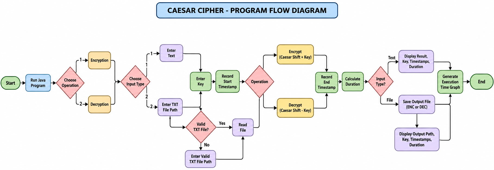

# CAESAR CIPHER — Java Encryption & Decryption

A console-based Java implementation of the classical Caesar Cipher supporting **text input**, **UTF-8 `.txt` files**, **user-defined integer keys**, **start/end timestamps**, **elapsed processing time**, and **PNG execution-time graphs**.



## 1. What is the Caesar Cipher?

The **Caesar Cipher**, also called the **shift cipher**, is a classical encryption technique that replaces each alphabetic letter with another letter a fixed number of positions away in the alphabet. It is a **monoalphabetic substitution cipher**: a given plaintext letter always maps to the same ciphertext letter under a fixed key. Letters wrap around at the end of the alphabet (for example, with key 3, X becomes A).

## 2. Origin and history

- **Associated with:** Roman general and statesman **Gaius Julius Caesar (100–44 BCE)**.
- **When:** Documented use dates to the **first century BCE**, commonly described as around **58 BCE**. There is no verified exact invention date, and earlier substitution techniques existed.
- **Purpose:** To obscure confidential correspondence, including military-related messages, if intercepted.
- **Historical key:** Caesar is reported to have used a shift of **3** (A → D, B → E, etc.).
- **Evidence:** Roman historian **Suetonius**, writing after Caesar's lifetime, described Caesar's practice of shifting letters in confidential writing.
- **Historical caution:** Caesar Cipher was not the first encryption method, and its exact effectiveness in ancient Rome is uncertain.

## 3. Cipher classification and key system

| Property | Description |
|---|---|
| Cryptography family | Classical cryptography |
| Cipher type | Substitution / shift cipher |
| Mapping | Monoalphabetic (one fixed alphabet shift) |
| Key system | **Symmetric-key**: same secret shift number is used to encrypt and decrypt |
| Key form | Integer shift (e.g., 3, 5, 13) |
| Alphabet | 26 English letters in this implementation |
| Distinct shifts | 26 (0–25), of which **25** are non-identity |
| Key exchange | Sender and receiver must agree on the shift privately |
| Modern security | **Not secure** for sensitive data |

The program accepts integer keys, including negative and large values. Keys are effectively reduced **modulo 26**. Thus, key 29 behaves like key 3; key 0 does not change letters.

## 4. How encryption and decryption work

For letters numbered A=0, B=1, …, Z=25:

- **Encryption:** `E(x) = (x + k) mod 26`
- **Decryption:** `D(y) = (y - k + 26) mod 26`

Here, `x` is a plaintext letter index, `y` is a ciphertext letter index, and `k` is the key reduced modulo 26.

**Example (key = 3):**

```text
Plaintext : HELLO WORLD
Key       : 3
Ciphertext: KHOOR ZRUOG
Decrypted : HELLO WORLD
```

**Letter mapping (key 3):**

```text
Plain : ABCDEFGHIJKLMNOPQRSTUVWXYZ
Cipher: DEFGHIJKLMNOPQRSTUVWXYZABC
```

This Java implementation preserves upper/lowercase, spaces, digits, punctuation, and other non-English-alphabet characters. Only `A–Z` and `a–z` are shifted.

## 5. Project files

```text
CAESERCIPHER.java      Main Java source code
README.md               This project documentation
FLOWDIAGRAM.png         Execution flowchart
sample.txt              Optional input example
sample_ENC.txt          Example encrypted output
sample_ENC_DEC.txt      Example decrypted output
encryption_time.png     Generated encryption-time graph
decryption_time.png     Generated decryption-time graph
```

The output `.txt` and graph files are created when their respective operations are run. The graphs show a **single measured duration for the current run**, not a multi-run benchmark.

## 6. Requirements and execution

- Java Development Kit (**JDK 11 or newer**)
- Terminal / Command Prompt
- No third-party libraries required (Java standard library only)

**Compile:**

```bash
javac CaesarCipher.java
```

**Run:**

```bash
java CaesarCipher
```

**Alternative source-file execution (JDK 11+):**

```bash
java CaesarCipher.java
```

**Note:** Java requires the public class name and file name to match. Therefore use `CaesarCipher.java`, not `CEASER-CIPHER.java`.

## 7. Program execution flow

1. Start the program.
2. Select `1 : ENCRYPTION` or `2 : DECRYPTION`.
3. Select `1 : TEXT` or `2 : FILE`.
4. Enter text, or provide an existing, readable **`.txt`** file path.
5. Enter an integer `KEY`.
6. Record the start timestamp and high-resolution timer.
7. Apply the forward or reverse Caesar shift.
8. If file mode is selected, write the processed text to a new `.txt` file.
9. Record the end timestamp and elapsed processing time.
10. Display the input/output information, key, start time, end time, and duration.
11. Generate `encryption_time.png` or `decryption_time.png`.

**See:** [`FLOWDIAGRAM.png`](FLOWDIAGRAM.png)

## 8. Input and output rules

| Mode | Input | Result |
|---|---|---|
| Encrypt text | `Hello World`, key 3 | `Khoor Zruog` displayed |
| Decrypt text | `Khoor Zruog`, key 3 | `Hello World` displayed |
| Encrypt file | `message.txt` | `message_ENC.txt` |
| Decrypt file | `message_ENC.txt` | `message_ENC_DEC.txt` |

- **File input restriction:** only an existing, readable file with a `.txt` extension is accepted.
- **Encoding:** UTF-8 for reading and writing text files.
- **Original file:** remains unchanged, except that a previously existing output file with the generated name can be **overwritten**.
- **Decryption:** use the same integer key as encryption.
- **Graph filenames:** reused on subsequent runs of the same operation, so previous graphs can be overwritten.
- **Text mode:** the transformed text is printed to the terminal; no `.txt` output is created.

## 9. Timestamps and performance graph

The program prints:

```text
KEY         : 3
START TIME  : 2026-10-23 05:56:14.531639379
END TIME    : 2026-10-23 05:56:14.532388648
DIFFERENCE  : 0.062735 ms (62735 ns)
GRAPH FILE  : /path/to/encryption_time.png
```

**Timing details:**

- Start and end timestamps use the computer's local date/time and a format with nine fractional-second digits. The actual clock accuracy may be lower than nine digits.
- Elapsed time uses `System.nanoTime()`, which is appropriate for measuring durations.
- Elapsed time is displayed in **milliseconds** and **nanoseconds**.
- File-mode timing includes cipher processing and writing the output file; it **does not** include reading the input file.
- Graph creation and terminal output are outside the timed section.
- Performance varies by file size, machine, operating system, JVM warm-up, and other activity. A single graph bar is not a rigorous performance benchmark.

## 10. Advantages

1. **Simple:** easy to learn, explain, and implement.
2. **Fast:** needs only basic character arithmetic.
3. **Minimal resources:** no external cryptography library required.
4. **Reversible:** the same shift value decrypts the message.
5. **Educational:** demonstrates substitution, modular arithmetic, symmetric keys, and cryptanalysis.
6. **Convenient for puzzles:** suitable for classroom exercises and recreational ciphers.

## 11. Disadvantages

1. **Tiny key space:** there are only 25 non-trivial shifts, so all can be tested rapidly.
2. **Vulnerable to brute force:** an attacker does not need to know the key beforehand.
3. **Vulnerable to frequency analysis:** letter-frequency patterns remain visible, merely shifted.
4. **Predictable mapping:** identical letters always encrypt to identical letters.
5. **No integrity protection:** modified ciphertext is not detected or authenticated.
6. **No meaningful modern confidentiality:** unsuitable for passwords, banking, private files, or secure communication.
7. **Limited transformation:** this implementation leaves punctuation, numbers, and non-Latin characters unchanged.
8. **Key sharing problem:** the communicating parties must agree on the shift, but the cipher does not provide a secure way to exchange it.

## 12. Why did people stop using it for security?

There was **no single date when everyone stopped using Caesar Cipher**. As cryptanalysis improved and communication security requirements increased, simple fixed-shift substitution became inadequate. An adversary can test every non-trivial shift (at most 25), often recovering the message immediately. Statistical **frequency analysis**, systematically described by the scholar **Al-Kindi in the ninth century CE**, also exposed the weakness of simple substitution ciphers.

More sophisticated historical ciphers and, eventually, modern computer-based cryptography displaced it for serious protection. Today, systems use vetted algorithms and protocols such as **AES** for symmetric encryption and **TLS** for secure communication. Caesar Cipher remains useful primarily for **teaching, demonstrations, and puzzles**.

## 13. Brute-force example

For ciphertext `KHOOR`, testing all 25 useful shifts will reveal `HELLO` at shift 3. This attack does not require advanced computing resources.

## 14. Limitations of this Java project

- It is a **learning project**, not production-grade encryption.
- It transforms only English alphabetic characters.
- The key is displayed openly in the console, as requested.
- It does not password-protect output files or authenticate data.
- It does not automatically store the key alongside the encrypted file; users must remember it.
- The PNG timing chart is a visual summary of **one execution**, not a comparison of many executions.

## 15. Learning outcomes

By completing this project, students can learn classical encryption/decryption, symmetric keys, modular arithmetic, file input/output in Java, string manipulation, input validation, timestamp handling, elapsed-time measurement, and basic graph generation.

## 16. References and further reading

1. Khan Academy, *The Caesar Cipher*: https://www.khanacademy.org/computing/computer-science/cryptography/ciphers/a/caesar-cipher
2. MIT Press Reader, *A History of Cryptography From the Spartans to the FBI*: https://thereader.mitpress.mit.edu/a-history-of-cryptography-from-the-spartans-to-the-fbi/
3. Rutgers University, *Foundations and Classical Ciphers*: https://people.cs.rutgers.edu/~pxk/classes/419/notes/crypto-1.html
4. University of Southampton, *Applications to Cryptography*: https://personal.soton.ac.uk/jhr/math1001/chapter-cryptography.html
5. HISTORY, *8 Ciphers That Shaped History*: https://www.history.com/articles/ciphers-secret-codes-enigma-morse

---

**Project:** Caesar Cipher — Text and `.txt` File Encryption/Decryption with Key, Timestamps, and Performance Graphs  
**Language:** Java  
**Purpose:** Educational demonstration of classical cryptography
